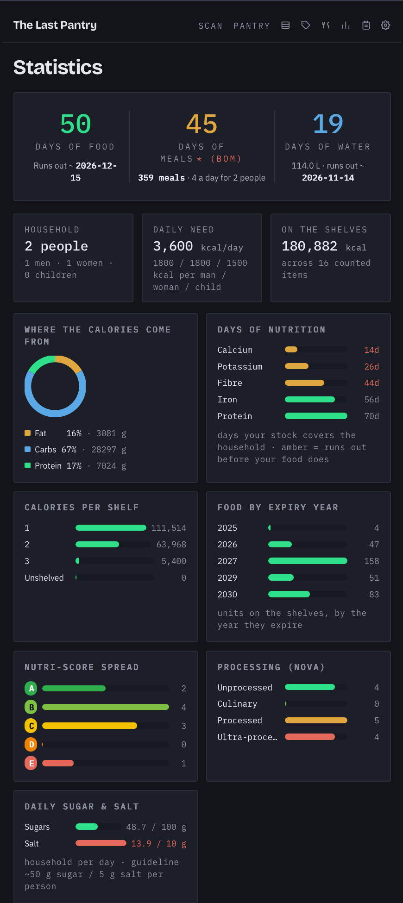
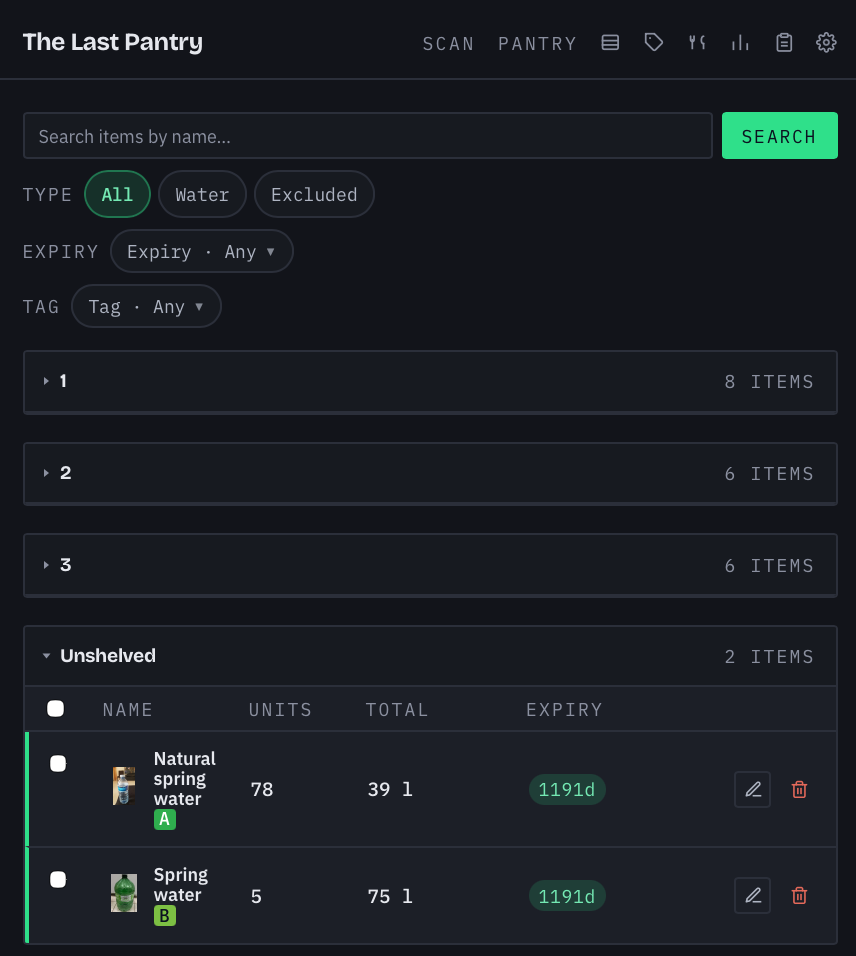
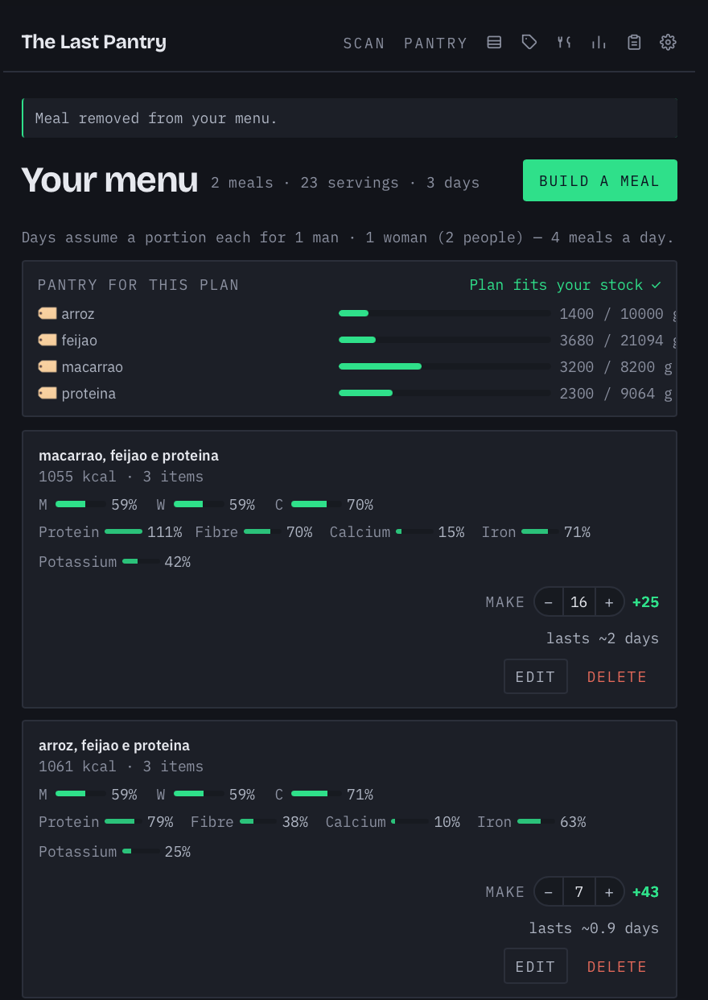
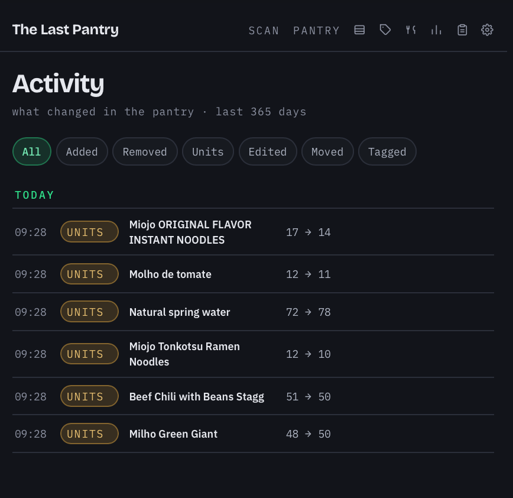
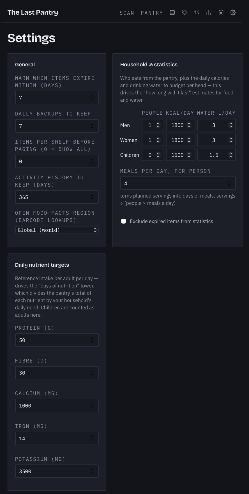
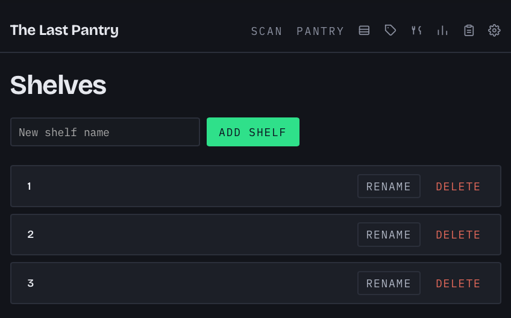

# The Last Pantry

A small self-hosted pantry tracker for people who keep a deep stock of food and
water and want to know how long it lasts. Scan a barcode with your phone, the
product details come from Open Food Facts, and the statistics page tells you how
many days of food, water and nutrition are on the shelves for your household.

Server-rendered Flask, SQLite, vanilla JS. No build step, no frontend framework,
no accounts to sign up for. Runs from a single Docker container.

## What it does

- **Pantry**: searchable, filterable table of everything you own, grouped by
  shelf, with expiry highlighting and a mobile card layout.
- **Barcode scanning**: point the phone camera at a product to add it or to
  adjust its count. Nutrition facts, photo and name are pulled from Open Food
  Facts; you can fill them by hand too.
- **Shelves and tags**: organise items by physical location and free-form tags.
- **Statistics**: days of food, days of water, days of nutrition per key
  nutrient, calories by macro, stock by expiry year. All driven by the household
  you configure (adults, children, daily needs).
- **Meals**: build meal plans from pantry products and see how many days of
  meals the stock covers at your meals-per-day setting.
- **Activity log**: every stock change in one feed, what moved and when.
- **Your data stays yours**: a plain CSV of the whole pantry is rewritten after
  every change, and the database is backed up daily. See [Your data](#your-data).
- **Single password** in front of everything, changeable from Settings.

## Screenshots

<p align="center">
  
</p>

| Pantry | Meals |
|---|---|
|  |  |

| Activity | Settings |
|---|---|
|  |  |

| Shelves |
|---|
|  |

## Quick start (Docker)

```sh
cp docker-compose.example.yml docker-compose.yml
docker compose up -d --build
```

Open <http://localhost:8000>. The default password is `admin`; change it in
Settings. Everything the app writes (database, backups, CSV mirror, photos)
lands in `./data`, which is the only thing you need to keep.

Barcode scanning needs a secure context on phones, so put the app behind HTTPS
(any reverse proxy will do) if you want to scan from a device other than the
host.

## Running locally

```sh
python3 -m venv .venv
.venv/bin/pip install -r requirements-dev.txt
DATA_DIR=./data .venv/bin/flask --app app run --debug
```

Tests:

```sh
./run_tests.sh
```

## Your data

The app is built on the assumption that it might die and the pantry must not
die with it. Everything lives in one folder, `DATA_DIR` (`./data` locally,
`/data` in the container):

| What | Where | When |
|---|---|---|
| SQLite database | `pantry.db` | live |
| CSV mirror of the whole pantry | `pantry_export.csv` | rewritten after every change |
| Timestamped database backups | `backups/pantry-YYYYMMDD-HHMMSS.db` | once a day on the first request, plus "Backup now" in Settings |
| Product photos | `images/` | downloaded when an item is scanned |

The CSV is the continuity plan: if the app or its infrastructure is gone, the
pantry is still a readable spreadsheet with name, barcode, units, expiry, shelf,
tags and nutrition. It can also be downloaded any time from Settings.

Backups are pruned to the newest N, where N is the "daily backups to keep"
setting (default 7, a rolling week). Copy the whole `data` folder and you have
moved the app.

## Configuration

There are no config files. Everything lives in the Settings page: household
size, daily calorie and water targets, expiry warning window, backup retention,
Open Food Facts country, meals per day. `DATA_DIR` (default `./data`, `/data` in
the container) is the one environment variable.

## Architecture

- `app.py` wires the routes and renders templates; business logic lives in `src/`.
- `src/` holds one module per concern: `database` (schema, migrations),
  `models` (pantry items), `shelves`, `tags`, `meals`, `stats` (the forecasts),
  `offfacts` (Open Food Facts lookups), `backup` (CSV mirror, backups),
  `activity` (the change log), `settings`, `auth`.
- `templates/` has one Jinja file per page plus `base.html`; `static/css/pages/`
  and `static/js/pages/` mirror that, with shared bits in `app.css` and `app.js`.
- SQLite, no ORM. Schema changes are additive migrations in `database.py`.
- `tests/` is pytest against a throwaway database, one file per module.

## Credits

- Product data from [Open Food Facts](https://world.openfoodfacts.org/), under
  the Open Database License.
- Barcode decoding by [ZXing for JS](https://github.com/zxing-js/library),
  Apache License 2.0, vendored under `static/js/vendor/zxing/`.

## License

GNU Affero General Public License v3.0, see [LICENSE](LICENSE).
